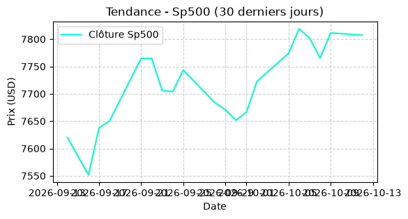

# Market Supervisor — Logiciel de Scan Boursier & Tracker de Take Profit (V1.5)

**Exécutable local et autonome sous Windows pour surveiller vos actifs critiques en temps réel, sans abonnement SaaS ni configuration technique.**

👉 **[Télécharger l'exécutable clé en main (.exe) sur Gumroad (29,99 € - Licence à vie)](https://beezeweb.gumroad.com/l/market-supervisor)**

---

## Pourquoi Market Supervisor ?

La majorité des solutions de suivi boursier imposent un dilemme : payer un abonnement mensuel récurrent pour une plateforme lourde, ou maintenir soi-même des scripts Python avec leurs dépendances.

**Market Supervisor (Premium V1.5)** résout ce problème avec une approche directe :
* **Zéro dépendance :** Compilé sous forme d'exécutable autonome (`Market_Supervisor_Premium.exe`), aucune installation Python n'est requise sur votre machine.
* **100 % Local & Privé :** Le logiciel interroge les flux en direct et génère vos fichiers sur votre bureau, sans serveur intermédiaire ni collecte de données.
* **Achat unique :** Pas de frais récurrents (29,99 € en paiement unique).

---

## Fonctionnalités & Actifs surveillés

En un clic sur **`LANCER LE SCAN`**, le moteur interroge simultanément 4 piliers de marché et compare les cours actuels à vos seuils cibles :

1. **S&P 500 (`^GSPC`)** — Indice directeur américain
2. **Nasdaq (`^IXIC`)** — Valeurs technologiques
3. **Or (`GC=F`)** — Valeur refuge et matières premières
4. **Solana (`SOL-USD`)** — Marché crypto

---

## Livrables générés automatiquement

À la fin de chaque cycle d'analyse (environ 10 secondes), le logiciel exporte directement dans votre répertoire local :

* **Le rapport d'alertes (`rapport_opportunites.txt`) :** Liste claire des actifs ayant franchi leur cible de Take Profit.
* **Les 4 graphiques de tendance (`graphique_sp500.png`, `graphique_nasdaq.png`, `graphique_or.png`, `graphique_solana.png`) :** Courbes de clôture sur les 30 derniers jours générées en haute lisibilité pour un contrôle visuel immédiat.

---

## Installation & Démarrage rapide

L'archive officielle `Market_Supervisor_Premium.zip` contient uniquement l'essentiel :
1. Téléchargez et décompressez le fichier `.zip` dans le dossier de votre choix.
2. Consultez les instructions rapides dans `LISEZ-MOI.txt`.
3. Double-cliquez sur `Market_Supervisor_Premium.exe` et lancez votre premier scan.

---

## Obtenir la version compilée

Le code source n'est pas distribué publiquement. L'exécutable Windows prêt à l'emploi est disponible en téléchargement immédiat :

🔗 **[Accéder à Market Supervisor sur Gumroad](https://beezeweb.gumroad.com/l/market-supervisor)**
